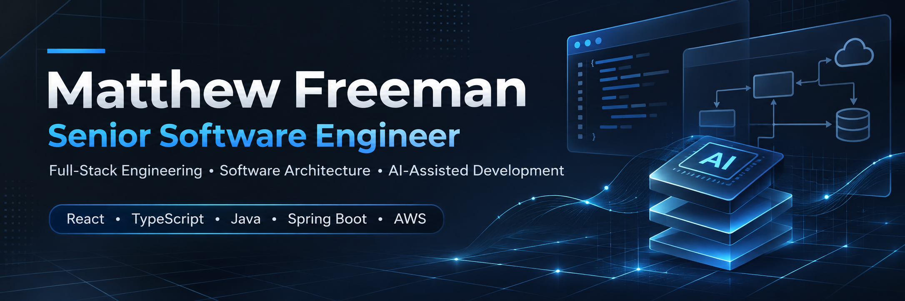

# Matthew Freeman

**Senior Software Engineer at Cognizant Technology Solutions**
React & TypeScript · Java & Spring Boot · Enterprise AI-assisted engineering

[Explore my engineering portfolio](https://matthewfreeman821.github.io/) · [BenchFlow](https://github.com/matthewfreeman821/benchflow) · [Shelf Sense](https://github.com/matthewfreeman821/shelf-sense)

I build enterprise interfaces, services, and integrations, with experience as a lead frontend/UI developer and React subject-matter expert. I progressed from contractor to Senior Software Engineer in approximately five years.

## Enterprise engineering

- Improved an API workflow from more than five minutes to approximately three seconds using Redis caching.
- Delivered complex PayPal and card-payment integrations.
- Implemented administrative authentication and account-management functionality.
- Built frontend automated testing foundations and tooling to clean up backend cached data.
- Designed an API Gateway/JWT-at-the-edge proposal, approved by the backend lead with broader review pending. This is an architectural proposal, not a deployed-system claim.

These are professional experience summaries. Employer source, client details, and internal artifacts remain private; the performance result is not a public benchmark.

## How I work with AI

I have used GitHub Copilot Enterprise since 2023 to accelerate development, evaluate solutions, and improve review quality. My workflow combines explicit acceptance criteria, bounded agent tasks, engineering review, and behavior-based verification. I investigate disagreements and reject unsupported findings; I own the final decision.

The portfolio’s [Review Ops](https://matthewfreeman821.github.io/#review-ops) explores that engineering process. See the portfolio repository for its implementation and current development status.

## Selected projects

### [BenchFlow](https://github.com/matthewfreeman821/benchflow)

A local repair-operations application built with **Python, FastAPI, SQLite, and JavaScript**. Typed commands, exact-version approvals, transaction-backed inventory reservations, revision checks, and idempotency make business rules explicit. Single-host Windows operation is an intentional limit; the app records payments and handovers without processing money.

[Architecture and tradeoffs](https://github.com/matthewfreeman821/benchflow/blob/main/ARCHITECTURE.md) · [Concurrency and rollback tests](https://github.com/matthewfreeman821/benchflow/blob/main/backend/tests/test_domains.py)

### [Shelf Sense](https://github.com/matthewfreeman821/shelf-sense)

A local-first book catalog built with **Python, FastAPI, SQLite, JavaScript, and optional Tesseract OCR**. Barcode and OCR results are suggestions for human review. CSV preview, backups, and explicit restore support data ownership. The app has no multi-user identity model and stays on loopback.

[Architecture and boundaries](https://github.com/matthewfreeman821/shelf-sense/blob/main/ARCHITECTURE.md) · [Acceptance tests](https://github.com/matthewfreeman821/shelf-sense/blob/main/tests/test_qa_acceptance.py) · [Limitations](https://github.com/matthewfreeman821/shelf-sense/blob/main/LIMITATIONS.md)

### [Author’s Board](https://github.com/matthewfreeman821/authors-board) — in development

A visual story-planning workspace for characters, places, events, and relationships. Public overview available; source and product previews are being prepared. It is not presented as a finished release.

## Technical foundation

**Interfaces:** React, TypeScript, JavaScript, frontend architecture
**Services and data:** Java, Spring Boot, REST APIs, SQL, PostgreSQL, Redis
**Delivery and systems:** Microservices, Docker, CI/CD, authentication and authorization
**AI engineering:** Copilot Enterprise, agent coordination, solution evaluation, review workflows

## Background

- B.S. in Mathematics & Quantitative Sciences, **4.0 GPA**.
- **Nine years of military service**, including deployment to Iraq.
- Contractor-to-senior progression, frontend leadership, and full-stack enterprise delivery.

[Explore the code, decisions, and evidence](https://matthewfreeman821.github.io/)
