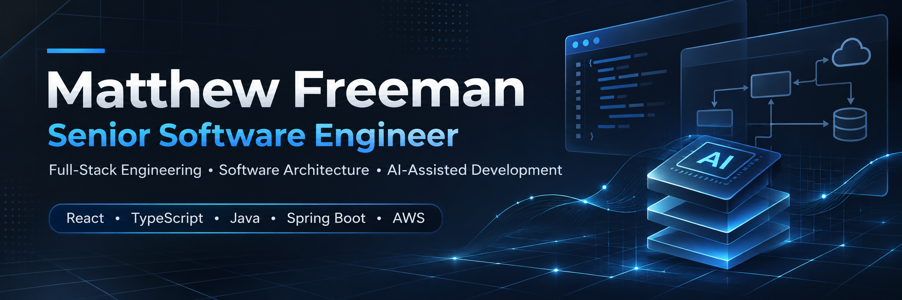

<div align="center">

### SENIOR SOFTWARE ENGINEER

**Full-Stack Systems · Software Architecture · AI-Driven Engineering**

Building reliable software. Designing thoughtful systems.
Using AI to push engineering forward.

[](https://react.dev/)
[](https://www.typescriptlang.org/)
[](https://www.java.com/)
[](https://spring.io/)
[](https://aws.amazon.com/)

</div>

---

## 01 / THE ENGINEER

I am a senior software engineer working across frontend architecture, backend services, authentication, and cloud infrastructure.

My background combines enterprise engineering with modern AI-assisted workflows—from implementing React interfaces to designing API integrations and solving performance problems.

**Engineering experience that matters:**

- Led frontend development across React-based applications.
- Worked across Java/Spring Boot services and enterprise integrations.
- Improved a slow API workflow from over five minutes to approximately three seconds using Redis caching.
- Developed AI-powered application experiences and applied agentic workflows to software delivery.

---

## 02 / HOW I ENGINEER WITH AI

I don't hide AI use. I make it part of the engineering process.

```text
    REQUIREMENTS
         │
         ▼
    ARCHITECTURE
         │
         ▼
    AI-ASSISTED DEVELOPMENT
         │
         ▼
    CODE REVIEW + VALIDATION
         │
         ▼
    TESTING + REFINEMENT
         │
         ▼
    DELIVERABLE SOFTWARE
```

**My principle:** AI can accelerate implementation. Engineering judgment determines whether the result is correct, maintainable, and fit for purpose.

---

## 03 / FEATURED ENGINEERING

### [BENCHFLOW](https://github.com/matthewfreeman821/benchflow)
**Repair Operations · Business Workflows · Reliability**

[](https://github.com/matthewfreeman821/benchflow)

`Python` `SQLite` `Workflow Design` `Authorization` `Testing`

Permission-aware repair workflows involving inventory, quality control, and traceable business operations.

**Explore:** [Source](https://github.com/matthewfreeman821/benchflow) · [Architecture](https://github.com/matthewfreeman821/benchflow/blob/main/ARCHITECTURE.md)

---

### [SHELF SENSE](https://github.com/matthewfreeman821/shelf-sense)
**Local-First Software · Data Management · OCR**

[](https://github.com/matthewfreeman821/shelf-sense)

`Python` `SQLite` `OCR` `Data Portability`

A personal library management application with local persistence, barcode scanning, OCR-assisted cataloging, and backup workflows.

**Explore:** [Source](https://github.com/matthewfreeman821/shelf-sense) · [Architecture](https://github.com/matthewfreeman821/shelf-sense/blob/main/ARCHITECTURE.md)

---

### [AUTHOR'S BOARD](https://github.com/matthewfreeman821/authors-board)
**Visual Story Planning · Connected Data · In Development**

`Python` `SQLite` `JavaScript` `Product Design`

A visual workspace for fiction writers to organize characters, places, events, and relationships while maintaining narrative consistency.

Designed around local-first data management, interconnected references, and preserving the distinction between author-entered information and calculated details.

**Explore:** [Project Repository](https://github.com/matthewfreeman821/authors-board)

*Active development. Public source and product previews forthcoming.*

---

<div align="center">

### BUILD WITH PURPOSE. VALIDATE WITH EVIDENCE.

**Engineering thoughtful software in an AI-driven world.**

</div>
